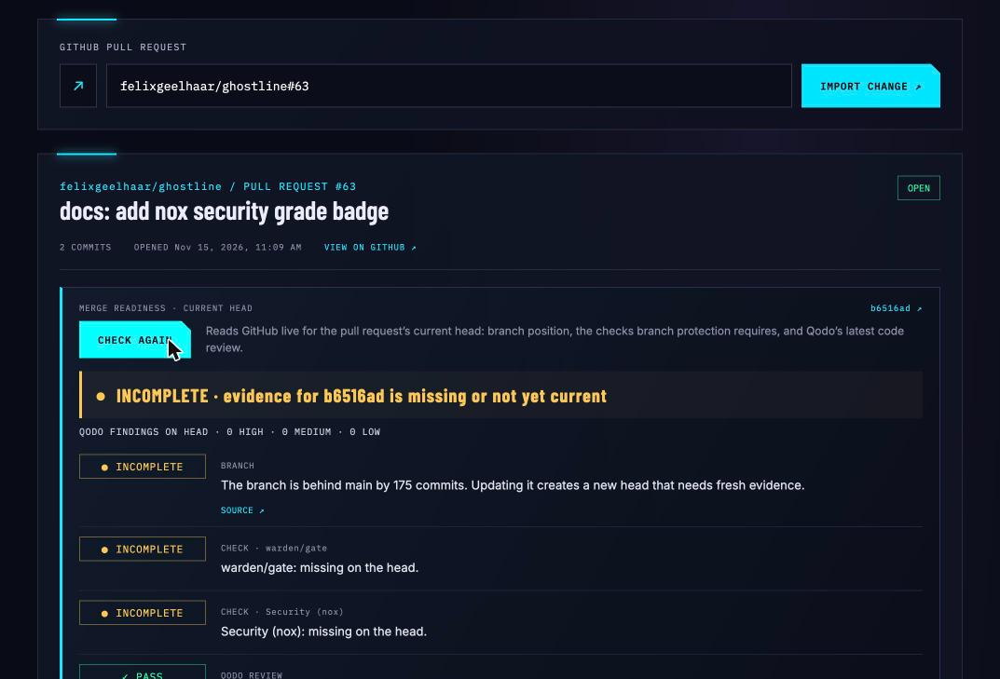

# Ghostline

**See the work. Trace the decisions. Take control.**

[](https://github.com/felixgeelhaar/ghostline/actions/workflows/ci.yml) [](https://github.com/felixgeelhaar/ghostline/actions/workflows/nox.yml) [](.github/workflows/nox.yml)

Ghostline tells you whether a pull request is ready to merge. It uses only evidence about the pull request's exact current commit, and it explains every gap.

Import a public GitHub pull request and select **Check merge readiness**. Ghostline reads GitHub live for the current head and gives one verdict:

- **PASS:** the pull request is open, not a draft, targets the default branch and is up to date with it; every check that branch protection requires passed on this head, and Qodo's latest code review covers this head with no High or Medium findings.
- **FAIL:** a required source reports a problem on this head.
- **INCOMPLETE:** evidence for this head is missing or not yet current. Each reason says which evidence and links its source.
- **NOT APPLICABLE:** the pull request is merged or closed, so there is nothing left to merge.



*v0.1.0-rc.11 on an open pull request: the branch is behind main and two required checks are missing on the head. [About this screenshot](docs/feature-evidence/readiness-verdict-rc11.md).*

Around the verdict, Ghostline shows the pull request's commit timeline, its GitHub checks with source-linked annotations, its Qodo review findings and the Nox security report, each labelled with the commit it describes.

## Try it

**Hosted:** https://ghostline.felixgeelhaar.de runs the latest release candidate. Sign in with GitHub, then import a pull request.

**Locally** (Go 1.27.4+ and Node.js 22.12+):

```sh
go run ./backend
```

In another terminal:

```sh
cd frontend
npm ci
npm run dev
```

Open the URL Vite prints. Or run `docker compose up --build` and open http://localhost:5173 ([Docker Compose guide](docs/docker-compose.md)).

**Import a pull request.** The import field takes a URL or `owner/repo#123`. A safe example is `felixgeelhaar/ghostline#152`: a small, merged pull request with GitHub checks and a Qodo review. Its readiness is NOT APPLICABLE because it's merged. Import any open public pull request to see a full verdict. When you're signed in with GitHub, typing anything else (three or more characters) searches your own public pull requests (`is:pr is:public involves:@me`) and lists matches to pick from; nothing is listed until you type.

**List a repository's open pull requests.** Enter `owner/repo` under **Open pull requests**, then select **Check readiness**. Each row shows its head, verdict and next action, such as "update branch: 3 behind main". Ghostline checks one pull request at a time and stops at the request limit. A list longer than 30 is labelled partial, and a row whose head moved is marked stale ([screenshot](docs/feature-evidence/open-pr-readiness.md)).

No token is needed for public pull-request data. To show Nox reports, set `GITHUB_TOKEN` with read access to Actions artifacts; without one, Ghostline reports Nox evidence as unavailable, not clean. See [Configuration](docs/configuration.md).

## What Ghostline won't do

- **Approve or merge.** Ghostline only reads. A PASS means every required source covered this head. It doesn't mean the change is correct.
- **Present stale evidence as current.** A check, review or scan describes only the commit it ran on. An earlier commit's result never counts for the current head.
- **Infer a clean report from a missing one.** A missing, expired, unreadable or untrusted report is shown as unavailable, never as "no findings".
- **Turn time order into cause.** Commit timestamps show when commits were authored, not when they were pushed, reviewed or fixed.

## Documentation

- [Project guide](docs/project-guide.md): product specification, architecture and the full setup path.
- [Configuration](docs/configuration.md): the GitHub token and the request rate limit.
- [Docker Compose](docs/docker-compose.md): the local stack and protected sign-in.
- [Hosted deployment](docs/hosted-deployment.md): the production single-container setup.
- [Repository checks](docs/repository-checks.md): Warden gates, CI, the Nox Security workflow, and how Ghostline trusts a Nox report.
- [Threat model](docs/threat-model.md): trust boundaries and hosting limits.
- [Qodo workflow](docs/qodo-workflow.md) and [factory verification](docs/factory-verification.md): how changes are reviewed and gated.
- Evidence: [check-run annotations](docs/evidence/check-run-annotations.md) (a labelled recorded replay), [hosted sign-in](docs/feature-evidence/hosted-github-sign-in.jpg) and [feature evidence](docs/feature-evidence/).

## Verify

```sh
go test ./...
cd frontend && npm test && npm run build
```

The frontend is organized by domain, application use cases and presentation. Zod validates API responses at the boundary.

See [Contributing](CONTRIBUTING.md) for the local workflow and [Security](SECURITY.md) for private vulnerability reporting.
