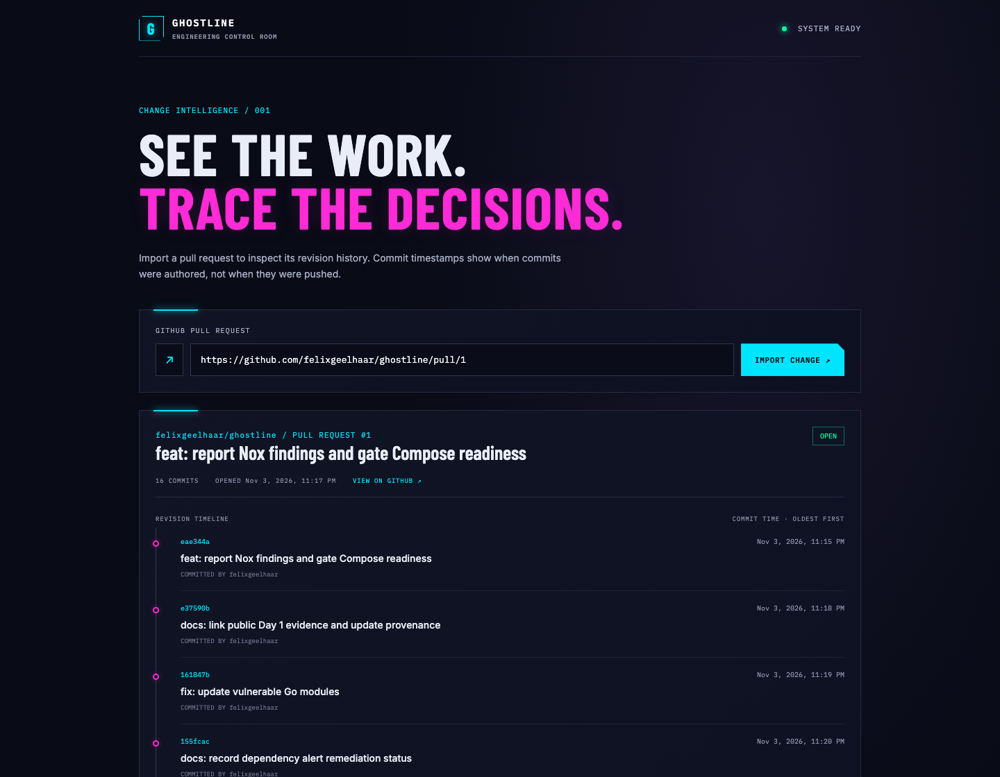

# Ghostline Day 1 delivery evidence

## What works

- Enter a public GitHub pull request URL and import its repository, number, title, state, source link, and commits through the Go/Gin API.
- The Vue 3 + TypeScript interface validates the URL with Zod and presents the returned commits in chronological order.
- Commit times are labeled as commit times. They describe when a commit was authored, not when it was pushed or the complete event history of a pull request.
- Docker Compose starts the frontend and backend; the frontend waits for backend health. The frontend binds to `0.0.0.0` on the configured port for access from the local network. This is a development/demo deployment, not a public hosted service.
- The screenshot below was captured from the running Compose app after importing Ghostline PR #1 at head `597a1e9` (16 commits). The API returned the live PR and its commits.

## Revision-linked checks

The implementation PR is [#1](https://github.com/felixgeelhaar/ghostline/pull/1), at head `597a1e9bd6c12b9c4cf63869094c22194a57c8f8` when these results were recorded. GitHub reported:

- [Go checks passed](https://github.com/felixgeelhaar/ghostline/actions/runs/41791043175/job/126444230457).
- [Frontend checks passed](https://github.com/felixgeelhaar/ghostline/actions/runs/41791043175/job/126444230619).
- [Nox security scan passed](https://github.com/felixgeelhaar/ghostline/actions/runs/41791043197/job/126444229537).
- `warden/gate` passed on the pull request.

Nox findings appear as workflow annotations; same-repository pull requests also receive inline finding comments and a summary issue comment. Fork pull requests remain read-only and retain the scan report as an artifact. An incomplete scan fails the action. The accepted baseline items and tool coverage limits are documented in the repository. These checks are CI evidence for the cited PR revision; the running demo itself is available on the developer's local network and is not a public hosted URL. The Day 1 interface does not yet display GitHub check runs.

## Qodo review observation

Qodo caught an incorrect argument order in the Nox shell wrapper. Warden now invokes Nox directly, and the wrapper was removed. This was a useful review because it exposed a real integration defect at the boundary between the developer gate and the scanner. A later review comment still mentioned the deleted wrapper, so review feedback must be checked against the current diff before acting on it.

## Scope and next increment

This delivery imports a public pull request and shows its commit history. It does not yet attach Qodo review findings or validation events to revisions, diagnose repair loops, or prove that a later commit fixed a finding. Those require source-backed events and are follow-up work.
