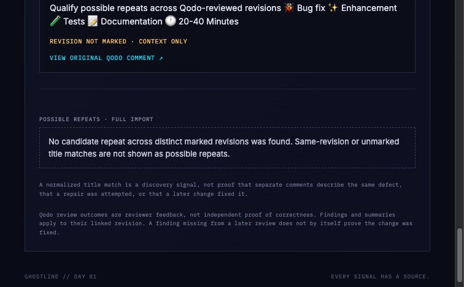

# Feature evidence

## Possible Repeats and Deep Trace

Captured from the running local Ghostline checkout after importing the public
[`felixgeelhaar/ghostline#7`](https://github.com/felixgeelhaar/ghostline/pull/7)
pull request. This is live GitHub data, not a prepared replay. The PR contains
one Qodo finding, so the Possible Repeats section correctly shows its empty
state. The screenshot captures the clarified explanation for same-revision
and unmarked title matches. The frontend interaction test covers a title match across two comments
and verifies that Deep Trace shows each source title and description while
calling the relationship a possible match.

## Possible repeats: distinct revisions (prepared replay)

[View screenshot](possible-repeats-distinct-revisions.jpg)

This screenshot uses a prepared replay fixture, not live Qodo data. It contains four source comments with the same normalized title: two marked to the same revision, one marked to a second revision, and one without a revision. The Possible Repeats list counts one occurrence per distinct marked revision (two total). Deep Trace retains all four source comments and labels same-revision and unmarked comments as context only. This demonstrates the distinction between candidate repeat evidence and full source history; it does not prove the underlying issue was repaired or establish causality.
