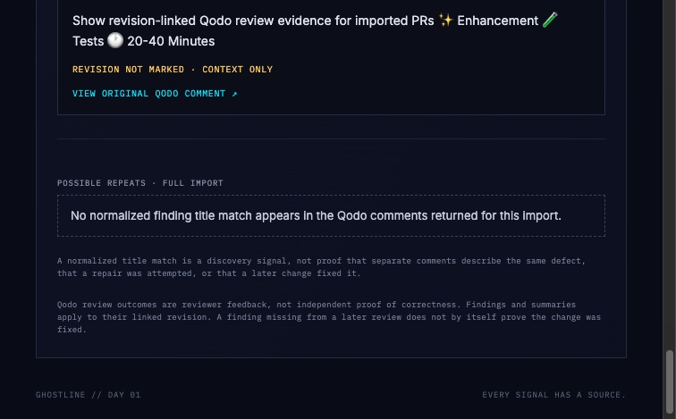

# Feature evidence

## Possible Repeats and Deep Trace

Captured from the running local Ghostline checkout after importing the public
[`felixgeelhaar/ghostline#7`](https://github.com/felixgeelhaar/ghostline/pull/7)
pull request. This is live GitHub data, not a prepared replay. The PR contains
one Qodo finding, so the Possible Repeats section correctly shows its empty
state. The frontend interaction test covers a title match across two comments
and verifies that Deep Trace shows each source title and description while
calling the relationship a possible match.
