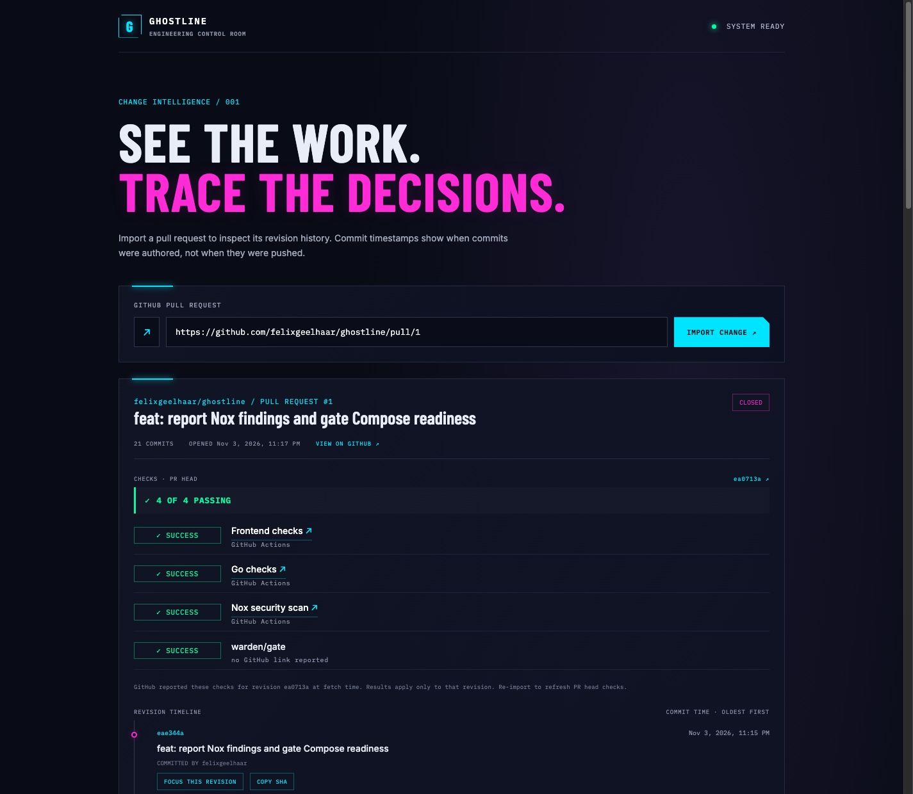

# Feature evidence

## Latest pull-request import wins

Captured from the running Compose build after exercising the issue 39 race in
Chrome: the response for PR #4 was held, PR #1 was imported and rendered, then
the earlier response was released. PR #1 remained displayed. The screenshot
shows the resulting product state; the delayed-response sequence is verified
by the DOM tests and the browser exercise, not inferred from the image alone.

The feature commit is `385c695`. The evidence commit adds this capture and the
setup documentation correction without changing application behavior.
