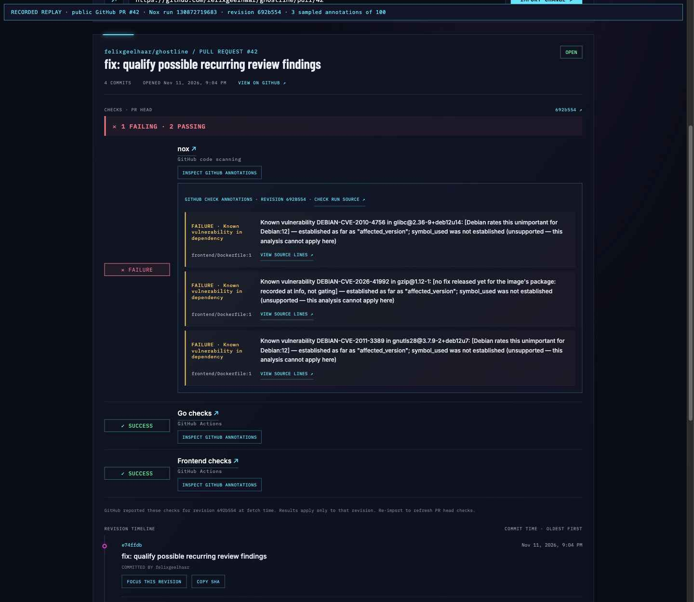

# Check-run annotation evidence

This screenshot shows the annotation panel in the working Ghostline UI. The page is explicitly marked **RECORDED REPLAY**: it uses three sampled findings from public Ghostline PR [#42](https://github.com/felixgeelhaar/ghostline/pull/42), recorded by Nox check run [130872719683](https://github.com/felixgeelhaar/ghostline/actions/runs/43124336264). The source run reported 100 annotations on revision `692b554c62c557f6aaa3657e85203ae745cf1b02`; the replay includes three of them. The check-run annotations endpoint and pagination were exercised against the recorded response. The screenshot does not claim a live GitHub request or current scan result.

Each displayed annotation includes the check-run revision, file and line, finding text, and a link to the cited source lines. The run's failure status is shown as GitHub reported it; Ghostline does not interpret the finding as confirmed exploitability.
