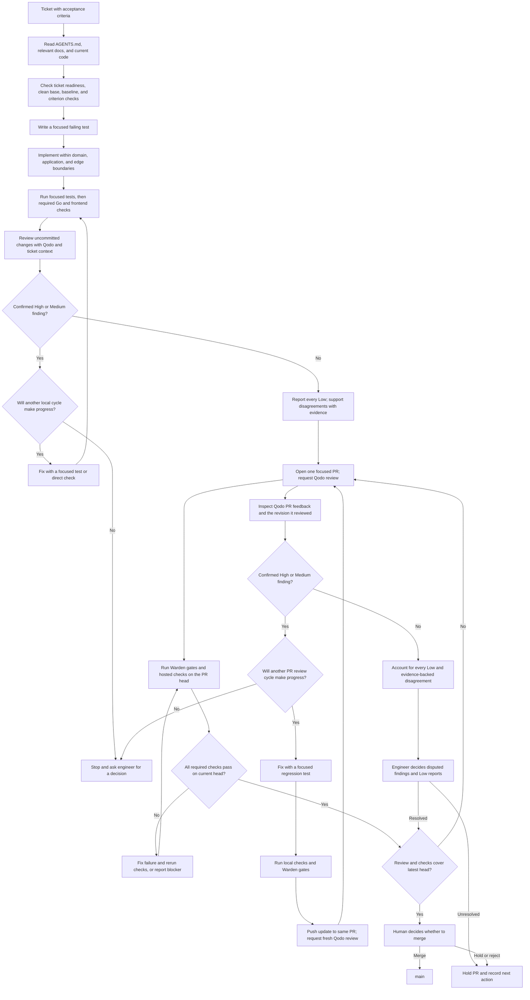

# Ghostline factory verification

This is the intended path from an accepted ticket to `main`. The agent owns
implementation and evidence collection; engineers own ambiguous findings,
stalled work, and the merge decision. A check or review only describes the
revision it inspected.

## Gates and decisions

- Before implementation, confirm the ticket is actionable, check for duplicate
  work, start from the intended clean base, record relevant baseline results,
  and map each criterion to a check. If a criterion or source is unclear, ask
  rather than inventing behavior.
- Use TDD for behavior changes: first add a focused failing test, then the
  smallest implementation. Keep domain rules out of HTTP and rendering edges.
- Before opening a PR, run the relevant tests and checks and review the complete
  local diff with Qodo using the ticket and project rules as context.
- On the PR, inspect Qodo's reviewed SHA and every finding. Fix confirmed High
  and Medium findings (including Medium Bugs) with a direct test or check; flag
  each Low for the engineer. For disagreements, record source, reproduction,
  or test evidence and get a human decision.
- Rerun checks after changes and request a new review. A review of an older head,
  an incomplete review, or a failed required check does not pass the gate.
- If a fix-and-review cycle stops making progress, stop and report the remaining
  evidence and decision needed. Agents do not merge; the engineer makes that
  decision after the latest head is reviewed and verified.

The repository's current commands and Warden gate are listed in
[`AGENTS.md`](../AGENTS.md). A screenshot is required in the delivery when a
feature changes the running UI; this document-only change has no changed UI to
capture.

## Walk-through against a real ticket

Issue [#39](https://github.com/felixgeelhaar/ghostline/issues/39) asked that
only the latest pull-request import could update the page, including its error
and loading states. It required clearing focused state and tests where an
earlier success or failure settled last. The ticket linked the project rules
and asked for TDD, Qodo review, and no merge by the agent.

Its implementation PR, [#44](https://github.com/felixgeelhaar/ghostline/pull/44),
closed the issue and recorded:

- DOM tests for an earlier success and failure settling last, plus an invalid
  latest import.
- Warden pre-commit and pre-push checks, Docker Compose startup, and an
  attended Chrome check of the changed behavior.
- A local full Qodo review of the current diff with no findings.
- A screenshot of the running app showing the latest import still displayed
  after the slower response settled.
- A successful `warden/gate` status on PR head
  `ec64bb18acf0129c96cfda19762f568109cb2276`; the PR is merged.

That record exercises ticket criteria, race-test coverage, local review,
quality gates, real UI verification, evidence capture, and a human merge. It
does **not** show a submitted GitHub PR review from Qodo: GitHub has no formal
review submission recorded for PR #44. The intended Qodo PR-feedback and
finding-repair path above is therefore documented but was not exercised by
this example. That distinction is part of the verification result, not a
claim that the PR received feedback it did not receive.

The available PR record confirms the race tests, but does not show that they
were observed failing before implementation; it also does not record a
pre-change baseline or duplicate-work check. Those remain workflow steps to
capture explicitly on a future run.
