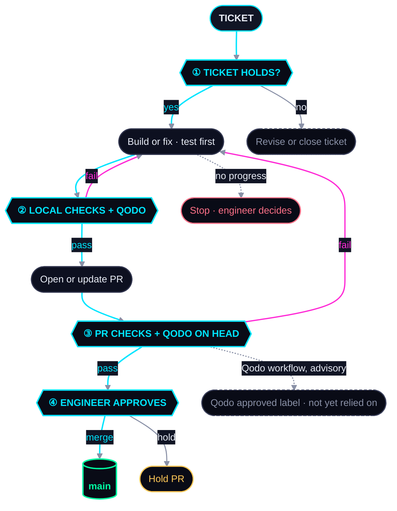
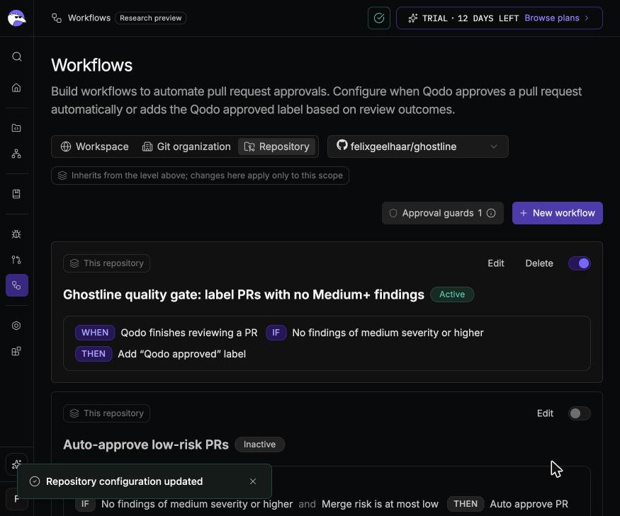
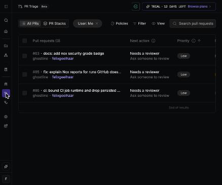

# Ghostline factory verification

This is the intended path from an accepted ticket to `main`. The agent owns
implementation and evidence collection; engineers own ambiguous findings,
stalled work, and the merge decision. A check or review only describes the
revision it inspected.

## The four gates

| Gate | Must pass | Evidence | If it fails |
|---|---|---|---|
| **① Ticket holds** | Codebase Wisdom finds no existing capability, missed dependency, or duplicate work; each criterion maps to a check | Wisdom answers checked against the cited code | Revise or close the ticket with that evidence; the engineer confirms |
| **② Local checks + Qodo** | Go, frontend, and Nox checks pass; Qodo's review of the uncommitted change leaves no confirmed High or Medium open, and every Low is reported | Check output and the Qodo review result | Fix with a test that fails first, then rerun; a disagreement needs evidence and the engineer's decision |
| **③ PR checks + Qodo on head** | The PR is ready for review, not a draft; Warden, hosted checks, and a completed Qodo review cover the exact current head; the branch is up to date with `main` | Every check and review names the SHA it covered; Warden runs again after a branch update | Same fix loop; a reported finding is never rerun to green, and a false positive needs an engineer-approved baseline entry; a job with no result gets one rerun |
| **④ Engineer approves** | The engineer decides disputed findings and the merge | The PR record against gates ①–③ | Hold the PR and record the next action |

**Label step (Day 14):** alongside gate ③, a Qodo workflow adds the "Qodo approved"
label when Qodo's review of the PR finds nothing rated Medium or higher. The
label is meant as a signal for gate ④, not an approval: it never approves or
merges, and Lows stay visible in the review. It has not been applied reliably
(see Day 14 below), so for now gate ④ ignores the label, present or missing. A label also does not show which
head it covers: Qodo applies it when a review finishes, and nothing observed so
far removes it after a later push. Gate ③'s comparison of the reviewed SHA
with the PR head stays the evidence that a review covers the current head.

**Stop rule:** if the same confirmed finding returns after one focused repair, a required check cannot be made to pass, or the evidence cannot settle a disagreement, the agent stops, reports the finding, repair attempt and revisions, and the engineer decides.

## Gate rules in detail

- Before implementation, investigate the ticket with Qodo Codebase Wisdom: ask
  which existing capability it touches, which components depend on that code,
  and whether the work already exists. Check every answer that influences the
  decision against the cited code. If the investigation shows the ticket is
  already delivered, wrong, or incomplete, revise or close it with that
  evidence and let the engineer confirm before building.
- Then confirm the ticket is actionable, check for duplicate
  work, start from the intended clean base, record relevant baseline results,
  and map each criterion to a check. If a criterion or source is unclear, ask
  rather than inventing behavior.
- Use TDD for behavior changes: first add a focused failing test, then the
  smallest implementation. Keep domain rules out of HTTP and rendering edges.
- Before opening a PR, run the relevant tests and checks and review the complete
  local diff with Qodo using the ticket and project rules as context.
- Open the PR as ready for review, or mark a draft ready before relying on
  Qodo: Qodo does not review draft PRs. Confirm a review has started for the
  current head instead of assuming it will.
- On the PR, inspect Qodo's reviewed SHA and every finding. Fix confirmed High
  and Medium findings (including Medium Bugs) with a direct test or check; flag
  each Low for the engineer. For disagreements, record source, reproduction,
  or test evidence and get a human decision.
- Include the repository's tracked-file Nox scan in local verification, and require
  the hosted Nox check on the PR head alongside Go, frontend, and Warden gates.
  Name the revision each result covers; a pass on an earlier head does not
  verify a later head.
- Before treating the PR gate as complete, compare GitHub's current `head.sha`
  with the commit SHA recorded by the latest completed Qodo review and with the
  revision each required check reports. Each value must match exactly. A missing
  or unreadable review/check revision is incomplete evidence; request a fresh
  review or check, and stop for an engineer if that evidence cannot be obtained.
  Repeat the comparison after every push; timestamps or comment order do not
  establish revision coverage.
- A failed required check that reported a finding is a real result, even if the
  same check passed on another run. Do not rerun it to get a green check. Fix
  the cause, or, for a false positive, ask the engineer to record a baseline
  entry with a written reason (AGENTS.md rule 5). Rerun a failed job once only
  when it produced no result because of the runner or network, and record the
  run link in the PR. If the rerun also produces no result, stop and ask the
  engineer.
- `main` requires branches to be up to date. Updating a branch, including
  GitHub's "Update branch" button, creates a new head that has no `warden/gate`
  status, because Warden publishes that status from a local run. Run the
  Warden pre-push gate on the new head, then wait for fresh hosted checks and a
  Qodo review of that head before asking for the merge.
- Qodo may not review a head that only merges `main` into the branch. On
  PR #86, Qodo refreshed its summary for the merge-only heads `7bff57b` and
  `4f57e3e` but posted no code review, and a `/agentic_review` request was
  acknowledged without producing one within 40 minutes. Gate ③ is then **not
  passed**: an earlier head's review does not cover the new head. The agent
  stops and reports the reviewed SHA, the merge-only heads, whether the PR's own
  diff changed, and the request it made. The engineer may still merge as a
  recorded override of gate ③. The PR states that the gate was not met and why
  the engineer accepted the risk, as #86 does. The agent never merges on an
  earlier head's review without that explicit decision.
- To avoid repeated merge-only heads, merge ready PRs one at a time and update
  each remaining branch only when it is next in line.
- Rerun checks after changes and request a new review. A review of an older head,
  an incomplete review, or a failed required check does not pass the gate.
- Stop for an engineer if the same confirmed High or Medium finding remains
  after one focused repair attempt, if a required check cannot be made to pass,
  or if evidence is insufficient to resolve a disagreement. Report the finding,
  attempted repair, revisions reviewed, and decision needed. Agents do not merge;
  the engineer decides after the latest head is reviewed and verified.

The repository's current commands and Warden gate are listed in
[`AGENTS.md`](../AGENTS.md). For every release, capture the actual release
candidate in working software and include screenshot evidence in the release
notes or delivery. A feature delivery also includes a screenshot of its changed
UI; a documentation-only change has no changed UI to capture.

## Walk-through against a real ticket

Issue [#39](https://github.com/felixgeelhaar/ghostline/issues/39) asked that
only the latest pull-request import could update the page, including its error
and loading states. It required clearing focused state and tests where an
earlier success or failure settled last. The ticket linked the project rules
and asked for TDD, Qodo review, and no merge by the agent.

Its implementation PR, [#44](https://github.com/felixgeelhaar/ghostline/pull/44),
closed the issue. The PR record was checked on 2026-11-16 and identifies
`ec64bb18acf0129c96cfda19762f568109cb2276` as its head revision. The PR body
records:

- DOM tests for an earlier success and failure settling last, plus an invalid
  latest import.
- Warden pre-commit and pre-push checks, including Go tests, `go vet`, frontend
  tests/build, and Nox, reported as passing on
  `ec64bb18acf0129c96cfda19762f568109cb2276`; Docker Compose startup and an
  attended Chrome check of the changed behavior (reported in the PR body, with
  no separate run log attached).
- A local full Qodo review of the current diff with no findings, reported in
  the PR body for that change. The record does not include a separate Qodo
  review artifact or reviewed SHA.
- A screenshot of the running app showing the latest import still displayed
  after the slower response settled. The image is linked from the PR body at
  `docs/evidence/latest-import-race.jpg` in that exact commit.
- A successful `warden/gate` status on
  `ec64bb18acf0129c96cfda19762f568109cb2276`; the PR is merged.

The issue and PR were also checked in GitHub on 2026-11-16. That record
exercises ticket criteria, race-test coverage, local review, quality gates,
real UI verification, evidence capture, and a human merge. It
does **not** show a submitted GitHub PR review from Qodo: GitHub has no formal
review submission recorded for PR #44. The intended Qodo PR-feedback and
finding-repair path above is therefore documented but was not exercised by
this example. That distinction is part of the verification result, not a
claim that the PR received feedback it did not receive.

The available PR record confirms the race tests, but does not show that they
were observed failing before implementation; it also does not record a
pre-change baseline or duplicate-work check. It records Warden's Nox gate, but
does not establish a separate hosted Nox result. Those remain workflow steps
and evidence to capture explicitly on a future run.

## Second walk-through: PR #69

[PR #69](https://github.com/felixgeelhaar/ghostline/pull/69) (Nox findings
reported as GitHub issues) was taken through the Day 9 quality gate on
2026-11-17. That run exercised the steps PR #44 did not:

- Two local Qodo reviews of the change, with the requirements and the gate as context, and three
  hosted Qodo reviews, each tied to its reviewed SHA.
- Six confirmed High or Medium findings fixed: five code bugs, each with a
  regression test observed failing first, and one documentation gap. One
  disagreement was backed by evidence and decided by the engineer.
- The "required check cannot pass" stop: Warden's Nox step blocked a commit on
  three new dependency advisories with no available fix. The engineer recorded
  a decision on [issue #45](https://github.com/felixgeelhaar/ghostline/issues/45#issuecomment-6960376515)
  and the baseline entries were merged in
  [PR #71](https://github.com/felixgeelhaar/ghostline/pull/71).
- The final head `853da64` had a completed Qodo review with no open findings
  and passing required checks on that SHA. The PR then waited for the engineer's
  merge decision.

The run also exposed four gaps, which this page now covers:

1. The pre-work investigation was implicit. Codebase Wisdom is now a named step
   with its own decision; a Day 6 Wisdom investigation found that issue #27 was
   already delivered.
2. PR #69 stayed a draft and received no Qodo review until it was marked ready.
3. GitHub's "Update branch" on PR #68 produced a head without a `warden/gate`
   status; the Warden pre-push gate had to be run locally on that head.
4. On PR #71 head `7a72b8b`, hosted Nox
   [run 44170424603](https://github.com/felixgeelhaar/ghostline/actions/runs/44170424603)
   failed on an AI-038 finding at `README.md:22`, which issue #66 tracks as a
   suspected false positive. The failed job was rerun on the same SHA and
   passed, and the PR was merged. That rerun turned a reported finding green
   without a baseline entry. The rule above no longer allows it: a reported
   finding must be fixed or baselined with the engineer's written reason.
   Issue #66 still needs that decision.

## Day 14: the gate as a Qodo workflow

Configured in the Qodo portal on 2026-11-21.

| Part | Setting |
|---|---|
| Scope | Repository `felixgeelhaar/ghostline` only |
| Trigger | Qodo finishes reviewing a PR |
| Condition | No findings rated Medium or higher |
| Action | Add the "Qodo approved" label. Auto-approve is not used |
| Protected paths | Approval guard in `felixgeelhaar/ghostline` on `.github/workflows/**`; extended later the same day to `.nox.yaml`, `.nox/**`, `.warden.yaml` and `AGENTS.md` (see Guard coverage) |
| Existing settings | No workspace-wide guards existed. The built-in "Auto-approve low-risk PRs" and "Label clean PRs" workflows stay inactive |

### Test PRs

| PR | Head | Touches the guarded path | Hosted Qodo review | Predicted | Observed |
|---|---|---|---|---|---|
| [#85](https://github.com/felixgeelhaar/ghostline/pull/85) explain unlinked Nox runs | `d006f64` | No | No High, Medium or Low findings | Label | Labelled "Qodo approved" by `qodo-code-review[bot]` at 08:55:24Z |
| [#86](https://github.com/felixgeelhaar/ghostline/pull/86) bound CI job runtime | `75c5f73` | Yes, only `.github/workflows/ci.yml` | No findings | No label | No "Qodo approved" label |
| [#87](https://github.com/felixgeelhaar/ghostline/pull/87) this record (head when tested) | `4668a02` | No | No findings | Label | No "Qodo approved" label |

#85 matched its prediction. #87 did not: it does not touch the guarded path and
its review found nothing, yet it got no label. So #86's missing label cannot be
attributed to the guard. #86 and #87 both received Qodo's short "no issues
found" comment, while #85 received the per-severity review. That is not the
cause either: [#88](https://github.com/felixgeelhaar/ghostline/pull/88) got a
clean per-severity review on `a4c3f5d` and does not touch a guarded path. Its
GitHub events show `qodo-code-review[bot]` adding "Qodo approved" and removing it
in the same second: both events carry 11:18:51Z, the API's resolution. After the next head, `cf9be89`, also reviewed
clean, the bot added the label at 11:23:39Z and it stayed. #86 and #87 have no
label events at all. The cause is unknown, and the portal shows no workflow run
history to check. Each review names its reviewed commit, and all
match the heads above. Required checks and `warden/gate` passed on all three
heads.

Result: the workflow is configured, but its behaviour is **not yet
established**. Two heads show the label kept (#85, and #88 at `cf9be89`); one
shows it added and removed at once. Two PRs with clean reviews never received
it: #86, which touches a guarded path, and #87, which does not. Neither the guard nor the
condition has been shown to decide a missing label. Until it is, gate ④ ignores
the label and relies on gate ③'s SHA-matched review. The diagram shows the
label as a dotted, advisory branch for that reason.

PR Triage listed #85 and #86 as "Needs a reviewer", with merge risk Medium for
#85 and Low for #86. The label didn't change the next action: both still wait
for a person.

### Guard coverage

On 2026-11-21 the engineer extended the guard to the other files that control a
gate: `.nox.yaml`, `.nox/**`, `.warden.yaml` and `AGENTS.md`, alongside
`.github/workflows/**`. Because the label's behaviour is not established, this
has not been tested separately. A PR that changes these files still needs the
engineer at gate ④, and baseline changes still need a written reason
(AGENTS.md rule 5).

Neither PR is merged by the agent; gate ④ is unchanged.
