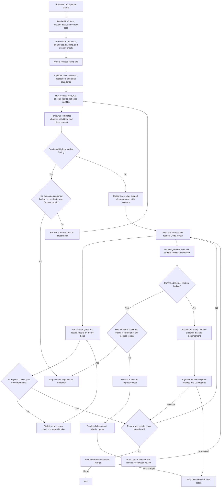

# Ghostline factory verification

This is the intended path from an accepted ticket to `main`. The agent owns
implementation and evidence collection; engineers own ambiguous findings,
stalled work, and the merge decision. A check or review only describes the
revision it inspected.

## Gates and decisions

- Before implementation, confirm the ticket is actionable, check for duplicate
  work, start from the intended clean base, record relevant baseline results,
  and map each criterion to a check. If a criterion or source is unclear, ask
  rather than inventing behavior.
- Use TDD for behavior changes: first add a focused failing test, then the
  smallest implementation. Keep domain rules out of HTTP and rendering edges.
- Before opening a PR, run the relevant tests and checks and review the complete
  local diff with Qodo using the ticket and project rules as context.
- On the PR, inspect Qodo's reviewed SHA and every finding. Fix confirmed High
  and Medium findings (including Medium Bugs) with a direct test or check; flag
  each Low for the engineer. For disagreements, record source, reproduction,
  or test evidence and get a human decision.
- Include the repository's tracked-file Nox scan in local verification, and require
  the hosted Nox check on the PR head alongside Go, frontend, and Warden gates.
  Name the revision each result covers; a pass on an earlier head does not
  verify a later head.
- Rerun checks after changes and request a new review. A review of an older head,
  an incomplete review, or a failed required check does not pass the gate.
- Stop for an engineer if the same confirmed High or Medium finding remains
  after one focused repair attempt, if a required check cannot be made to pass,
  or if evidence is insufficient to resolve a disagreement. Report the finding,
  attempted repair, revisions reviewed, and decision needed. Agents do not merge;
  the engineer decides after the latest head is reviewed and verified.

The repository's current commands and Warden gate are listed in
[`AGENTS.md`](../AGENTS.md). For every release, capture the actual release
candidate in working software and include screenshot evidence in the release
notes or delivery. A feature delivery also includes a screenshot of its changed
UI; a documentation-only change has no changed UI to capture.

## Walk-through against a real ticket

Issue [#39](https://github.com/felixgeelhaar/ghostline/issues/39) asked that
only the latest pull-request import could update the page, including its error
and loading states. It required clearing focused state and tests where an
earlier success or failure settled last. The ticket linked the project rules
and asked for TDD, Qodo review, and no merge by the agent.

Its implementation PR, [#44](https://github.com/felixgeelhaar/ghostline/pull/44),
closed the issue. The PR record was checked on 2026-11-16 and identifies
`ec64bb18acf0129c96cfda19762f568109cb2276` as its head revision. The PR body
records:

- DOM tests for an earlier success and failure settling last, plus an invalid
  latest import.
- Warden pre-commit and pre-push checks, including Go tests, `go vet`, frontend
  tests/build, and Nox, reported as passing on
  `ec64bb18acf0129c96cfda19762f568109cb2276`; Docker Compose startup and an
  attended Chrome check of the changed behavior (reported in the PR body, with
  no separate run log attached).
- A local full Qodo review of the current diff with no findings, reported in
  the PR body for that change. The record does not include a separate Qodo
  review artifact or reviewed SHA.
- A screenshot of the running app showing the latest import still displayed
  after the slower response settled. The image is linked from the PR body at
  `docs/evidence/latest-import-race.jpg` in that exact commit.
- A successful `warden/gate` status on
  `ec64bb18acf0129c96cfda19762f568109cb2276`; the PR is merged.

The issue and PR were also checked in GitHub on 2026-11-16. That record
exercises ticket criteria, race-test coverage, local review, quality gates,
real UI verification, evidence capture, and a human merge. It
does **not** show a submitted GitHub PR review from Qodo: GitHub has no formal
review submission recorded for PR #44. The intended Qodo PR-feedback and
finding-repair path above is therefore documented but was not exercised by
this example. That distinction is part of the verification result, not a
claim that the PR received feedback it did not receive.

The available PR record confirms the race tests, but does not show that they
were observed failing before implementation; it also does not record a
pre-change baseline or duplicate-work check. It records Warden's Nox gate, but
does not establish a separate hosted Nox result. Those remain workflow steps
and evidence to capture explicitly on a future run.
