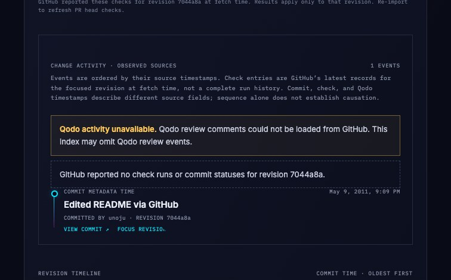

# Activity index check coverage

Captured from the running Ghostline app through Scout after importing the public pull request [octocat/Hello-World#1](https://github.com/octocat/Hello-World/pull/1). The screenshot shows the updated activity index status: GitHub reported no check runs or commit statuses for displayed revision `7044a8a`. Qodo activity could not be loaded and is labeled unavailable. This is a live app screenshot, not replay data; it records source availability at capture time and makes no claim about complete history.
