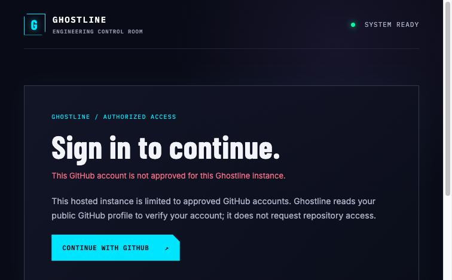

# Hosted GitHub sign-in error state

Captured from the running Ghostline feature branch with the hosted sign-in gate enabled. The callback error code is consumed from the URL and shown as a fixed message; the app does not expose provider response text. The screenshot uses local demo credentials and does not contain a real session or GitHub token.
