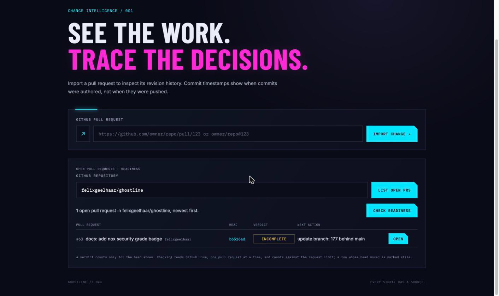

# Open pull requests with their readiness

Captured on 2026-11-26 from a local build of branch `feat/open-pr-readiness` (#94), with `go run ./backend` and the Vite dev server (the footer reads `dev`), signed out and without a GitHub token.

The list was read with the keyboard: type the repository, press Enter, tab to **Check readiness**, press Enter. `felixgeelhaar/ghostline` had one open pull request. Its verdict describes the listed head `b6516ad` only; the next action comes from the first unmet requirement, here the branch position. Listing `https://github.com/octocat/Hello-World` in the same session showed the first 30 open pull requests labelled PARTIAL, because GitHub held more.
