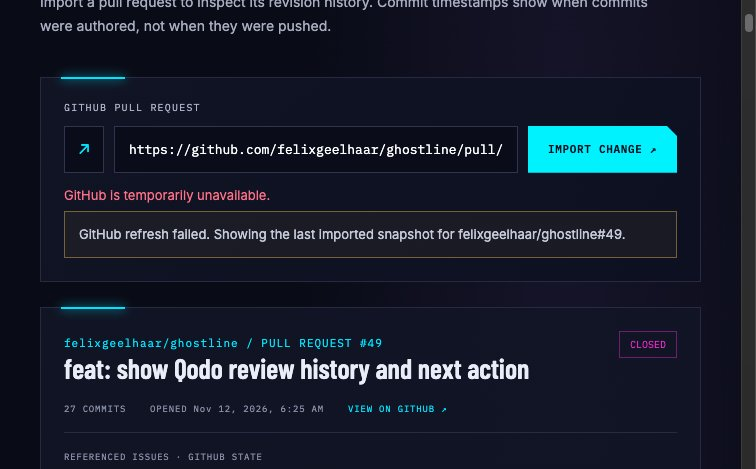

# Failed GitHub refresh retains the imported snapshot

This screenshot shows Ghostline after importing live public PR #49 data and retrying the same URL while a local demo proxy returned a simulated HTTP 502. The error banner identifies the refresh failure, and the status notice identifies the retained snapshot by repository and PR number. The outage is simulated; the initial PR data came from the running GitHub-backed application.
