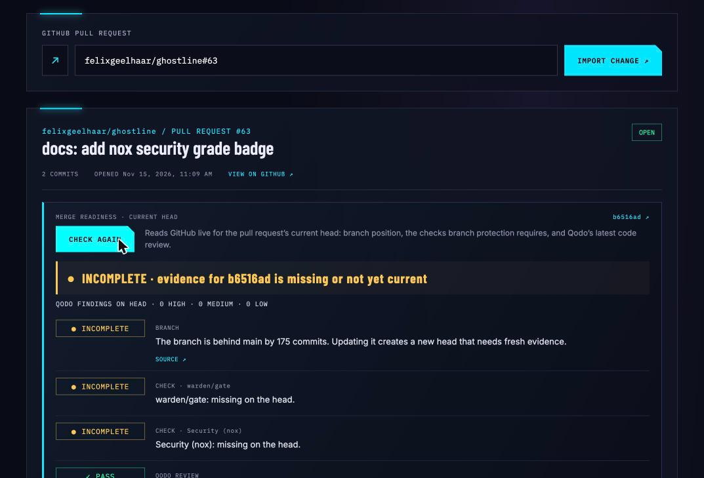

# Merge readiness verdict (v0.1.0-rc.11)

Captured on 2026-11-26 from https://ghostline.felixgeelhaar.de running `v0.1.0-rc.11@sha256:3aa15fbf1188244b833914b450c336180871314ef95df5146b4a59ad27019897`, the same screenshot as in the [rc.11 release notes](https://github.com/felixgeelhaar/ghostline/releases/tag/v0.1.0-rc.11).

`felixgeelhaar/ghostline#63` was open at the time. The verdict is INCOMPLETE for its head `b6516ad`: the branch was 175 commits behind main, and the required checks warden/gate and Security (nox) were missing on that head. Each reason links its GitHub source where one exists. The verdict describes that head when it was read; a later push or a change to main changes it.
