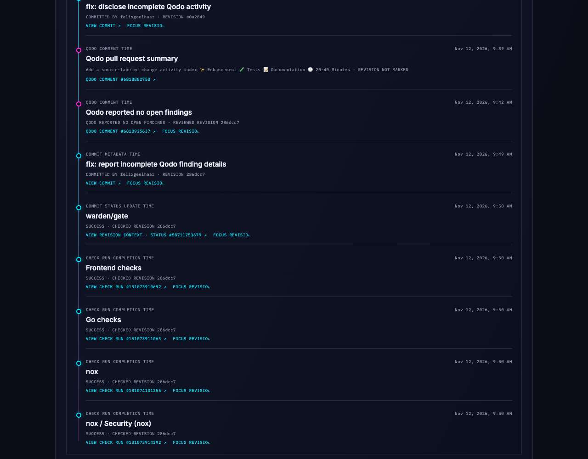

# Revision-linked check activity

Captured from the running Ghostline app in Chrome via Scout after importing [Ghostline PR #50](https://github.com/felixgeelhaar/ghostline/pull/50). The screenshot shows the PR's GitHub-reported commit status and check runs for revision `286dcc7`, with source timestamp labels and native GitHub record IDs. Each event links to its direct GitHub target when one is reported; when a commit status has no target URL, Ghostline labels the link as revision context. At capture time these were GitHub's latest check records for the PR head; this view is not a complete check-run history and does not imply that checks caused or repaired a change.
