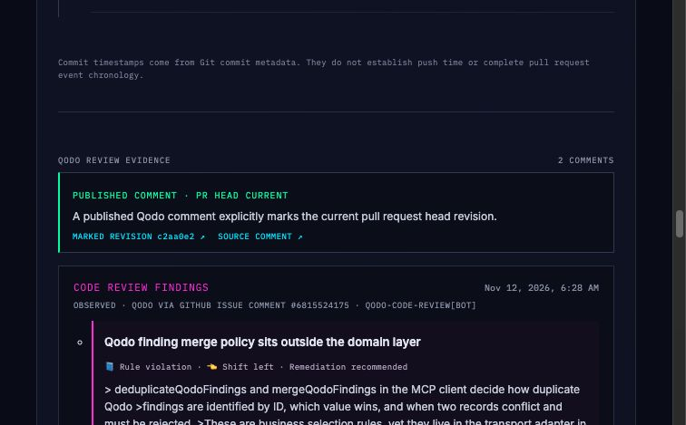
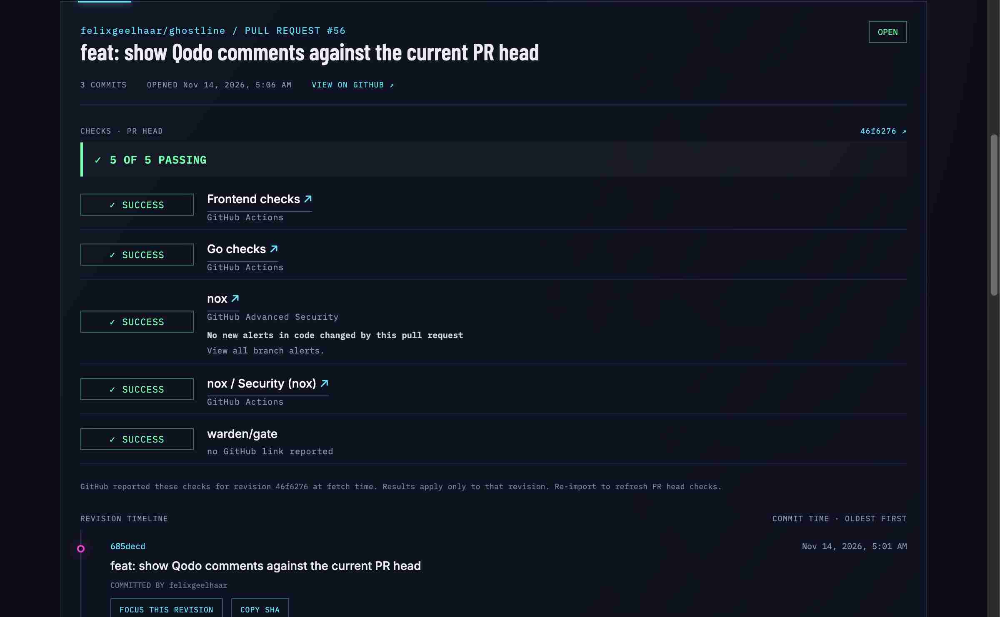
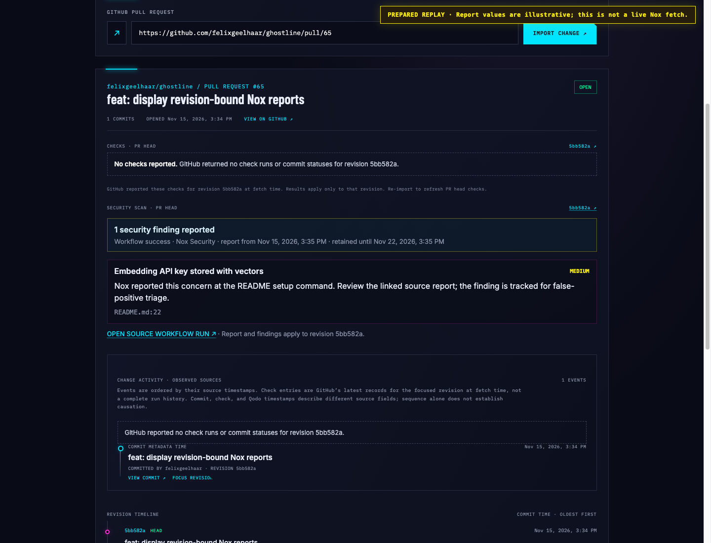

# Ghostline project guide

## Short specification

Ghostline is a change-centric engineering control room for engineers using coding agents. It imports a **public GitHub pull request** and presents its metadata, a source-labeled activity index, revision-linked GitHub checks, published Qodo review feedback, and Nox findings from the matching GitHub Actions report artifact. Nox results are accepted only when the artifact belongs to a workflow run for the requested PR revision; Ghostline shows the report source and expiry. GitHub check summaries and Nox SARIF remain linked to their original sources. It compares an explicit revision marker in a published Qodo comment with the current PR head; “current” means that comment names the head SHA, not that Ghostline found the latest complete review run. Repeated Qodo finding titles can be traced across comments when their revision markers support it. It also checks issue references in the PR description and highlights issues that remain open after the PR is merged. Warden runs local developer gates and Nox scans; repository CI also runs Nox.

The screenshot below shows the running app after importing Ghostline PR #56 at its earlier head `685decd`. The displayed Qodo comment, marked revision, and finding link to GitHub; this is live repository evidence captured for the feature, not a replay.



The check list below shows GitHub's Nox check-run title and a short summary preview for PR #56 head `46f6276`. The preview remains linked to its GitHub source; it is not a full Nox report or an independent claim that the repository has no security findings.



The Nox report panel links results from an artifact produced by this repository’s `.github/workflows/nox.yml` for the exact matched public PR revision, verifies GitHub’s artifact SHA-256 digest, and displays the scan revision and report expiry. Other workflows and private PRs are not accepted as Nox evidence. Active and SARIF-suppressed results are counted separately; suppressed results remain visible with their source kind and justification when supplied. Suppression does not mean a finding was fixed or verified. An unavailable or over-limit lookup is presented as unavailable evidence, not as a clean scan.

The screenshot below shows that panel in a prepared replay, not a live artifact fetch. It demonstrates the revision and workflow source labels; the report metadata is illustrative. [Evidence notes](feature-evidence/nox-report-revision-bound-replay.md).



The product helps an engineer inspect what changed, understand which revision review feedback and checks describe, and decide what to inspect next. GitHub remains authoritative for pull-request facts; Qodo remains the review source. Ghostline does not run agents, repair code, prove that a finding was fixed, or replace CI, Qodo, Nox, or Warden. It does not scan a developer’s local filesystem. Structured Qodo findings can be fetched for one imported public PR using a Qodo API key supplied for that request from a secure origin; Ghostline does not persist the key. Local demo mode has no login. Protected mode supports GitHub OAuth, signed 12-hour sessions, and an allowlist of immutable numeric GitHub account IDs; logout revokes the session in the current backend process, and the OAuth token is discarded after identity retrieval. OAuth state and revoked sessions are process-local, so protected mode currently requires a single backend instance.

Evidence labels and links must preserve source and revision. Commit timestamps are commit metadata, not push or review times. A later commit in the PR list is only a candidate to inspect; ordering alone does not establish that it repaired a finding. If evidence is missing or unavailable, the UI should say so.

## Architecture overview

Ghostline is a small Go API and Vue single-page application. It has no database or background worker; importing a PR fetches a current view from GitHub.

```text
Browser (Vue 3 + TypeScript)
  presentation: App.vue, ReviewCard.vue, DeepTrace.vue
  application: fetchGhostlineSession, importPullRequest, fetchRevisionChecks, fetchQodoReviewSession
  domain: pullRequest, checks, reviews, trace, change activity, referenced issues
          │ /auth/*, /api/session, /api/import, /api/checks, /api/nox-report, /api/qodo-review
          ▼
Go + Gin API
  GitHub OAuth callback, signed session, account-ID allowlist middleware
  HTTP handlers and GitHub response normalization
  GitHub client, referenced-issue lookup, check aggregation, Nox artifact/SARIF parsing, Qodo comment parsing
  fixed-endpoint Qodo MCP client
          ├─ HTTPS GitHub REST API → GitHub: pull requests, commits, checks, Actions runs/artifacts, published comments, referenced issues
          └─ HTTPS Qodo MCP → Qodo: structured findings and review runs
```

The frontend validates API payloads with Zod at the boundary in `frontend/src/domain`. Keep business rules in domain modules, request orchestration in application modules, and HTTP or rendering details at the edges. In the backend, domain concepts such as the canonical repository identity, Nox workflow/scanner acceptance, and normalized Nox finding interpretation live in `backend/internal/domain`; HTTP handling, GitHub calls, and orchestration stay in the small files under `backend`. Put new business rules in the domain package, and avoid adding infrastructure layers without a concrete need.

For code changes, preserve these domain boundaries and use test-driven development: write or update a focused failing test for the behavior first, then implement the smallest change that makes it pass.

The main request is `POST /api/import`: validate the submitted PR URL, fetch PR metadata and commits, fetch checks for the PR head, recheck the head SHA to avoid mixing snapshots after a force-push, fetch published Qodo issue comments, look up up to 20 issue references from the PR description, normalize the response, and render the source-labeled activity index and review evidence. `POST /api/nox-report` accepts a PR URL and full revision SHA, confirms that the revision belongs to a public PR, finds a matching `pull_request` run from `.github/workflows/nox.yml` and its `nox-results` artifact, verifies its run/SHA identity and mandatory published SHA-256 digest, then parses bounded Nox SARIF 2.1.0 without extracting files. GitHub request volume is capped at 32 API calls per report lookup, and workflow/artifact lookup is capped at ten pages of 100 records. If a request or history cap prevents a complete search, the response says the inspection was incomplete rather than claiming the report is missing. It presents findings with the exact SHA, workflow run, and artifact retention dates. Missing, expired, oversized, mismatched, unsupported, or inaccessible reports are explicitly unavailable; Ghostline does not describe them as clean. `POST /api/checks` fetches checks for a focused full commit SHA. `POST /api/qodo-review` sends the imported PR URL and a one-request Qodo key to Qodo's fixed MCP endpoint, then validates and normalizes the structured result. The key is never written to storage or returned to the browser by the API. Checks, Nox reports, and review sessions are tied to the revisions their source returned.

## Setup and verification

Requirements for a local run: Go 1.27.4 or newer, Node.js 22.12 or newer, and npm.

Run the API from the repository root:

```sh
go run ./backend
```

By default it listens at `http://localhost:8080` (`HOST` and `PORT` can override the bind address and port). The frontend's development proxy targets that address.

In another terminal, run the frontend:

```sh
cd frontend
npm ci
npm run dev
```

Open the URL Vite prints. The frontend proxies `/api` requests to `http://localhost:8080`. Public GitHub metadata and checks work without credentials but have a low rate limit; set the backend's `GITHUB_TOKEN` to raise it. Downloading a published Actions artifact for a Nox report also requires a token authorized to read Actions artifacts in the target repository. Without that access Ghostline marks the report unavailable, not clean. Do not expose a privileged token through the unauthenticated local or hosted API. Never commit or paste a token into a report.

Local mode leaves sign-in disabled. Protected OAuth mode is supported only when a trusted HTTPS ingress serves Ghostline at the same public origin as `GITHUB_OAUTH_CALLBACK_URL`; direct access to the local HTTP Vite URL is rejected by the same-origin check. Configure `GHOSTLINE_AUTH_MODE=required`, GitHub OAuth client ID and secret, the matching HTTPS callback, a 32-byte `GHOSTLINE_SESSION_SECRET`, and one or more numeric IDs in `GHOSTLINE_ALLOWED_GITHUB_IDS`. If the ingress proxies requests to Vite, set `GHOSTLINE_TRUSTED_PROXY_CIDRS` to its peer CIDRs and configure it to overwrite `X-Real-IP`. Local Vite proxies `/api` and `/auth` to the backend.

To run both services in containers:

```sh
docker compose up --build
```

Open `http://localhost:5173`, or the configured `GHOSTLINE_PORT`, for the unauthenticated local demo. Compose exposes the frontend on network interfaces by default; use `GHOSTLINE_BIND_ADDRESS` to select a bind address. The Compose backend does not currently receive `GITHUB_TOKEN`, so it cannot download Nox Actions artifacts unless a token is configured securely for the host. Do not add a privileged token to the unauthenticated development Compose service. Compose accepts the GitHub OAuth configuration described in the [README](../README.md#protected-hosted-mode-sign-in), but protected sign-in works only through the matching HTTPS ingress, and its frontend remains a Vite development server rather than production hosting.

Run the project checks:

```sh
go test ./... -count=1
go vet ./...
cd frontend && npm ci && npm test && npm run build
```

Warden configures pre-commit and pre-push gates in `.warden.yaml`. It runs the Go checks, frontend verification, and tracked-repository Nox scan. Install Warden and Nox as described in the [README](../README.md#repository-checks), then enable hooks in a fresh checkout with `warden init --hooks=pre-commit,pre-push`.

For detailed Qodo setup and review-evidence semantics, see [Qodo workflow](qodo-workflow.md). Repository rules for agents are in [AGENTS.md](../AGENTS.md).

For current trust boundaries, abuse cases, and hosting limitations, see the [threat model](threat-model.md).

## Feature evidence

A statusless Qodo run remains visible with an explicit `STATUS NOT RETURNED` label in the [feature screenshot](feature-evidence/qodo-run-missing-status.png). This is a prepared replay fixture, not a live Qodo response.

The running change activity index, imported from Ghostline PR #49, is shown in [this screenshot](feature-evidence/change-activity-index.jpg). The revision-linked GitHub check events are shown in [this screenshot](feature-evidence/revision-linked-check-activity.jpg), imported from Ghostline PR #50 at revision `286dcc7`. The empty-check state is shown in [this screenshot](feature-evidence/activity-index-check-coverage.jpg), captured from public PR `octocat/Hello-World#1` when GitHub reported no check runs or commit statuses for the displayed revision. Qodo activity was unavailable at capture time and the UI says so. These views show current records or fetch-time availability; they do not represent complete event history.

The current source-backed review timeline, imported from Ghostline PR #50 at revision `4bae19d`, is shown in [this screenshot](feature-evidence/activity-index-review-timeline.jpg). It shows observed commit and published Qodo comment events; it does not imply that event order proves a repair relationship. Parser-incompleteness and partial-check-placement warnings are edge states covered by tests, not present in this PR's current records.

The [live referenced-issues panel](feature-evidence/referenced-issue-live-2026-11-13.jpg) shows issue states imported from a public pull request. This example’s referenced issues are now closed; the merged/open warning is covered by UI tests using explicit fixtures.
