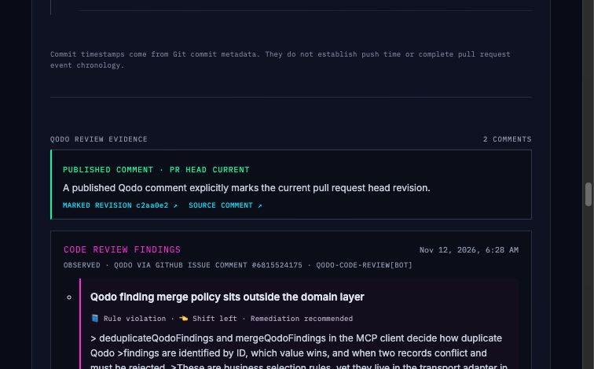
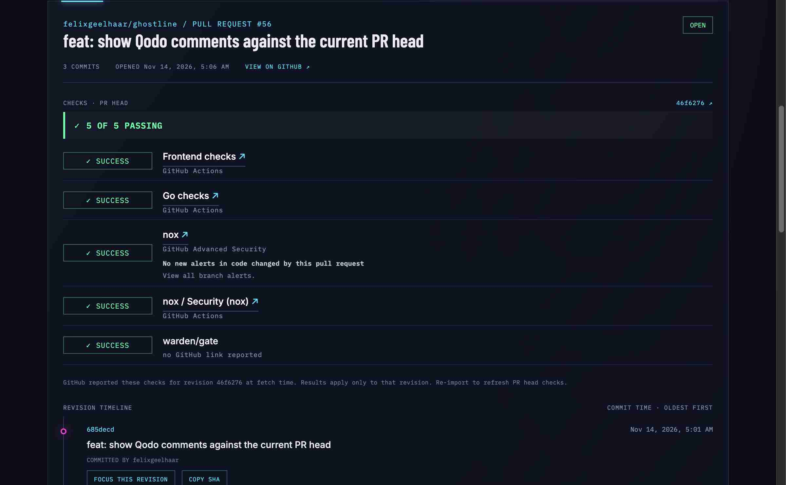

# Ghostline project guide

## Short specification

Ghostline is a change-centric engineering control room for engineers using coding agents. Its current slice imports a **public GitHub pull request** and presents the change’s metadata, commit history, revision-linked GitHub checks, and published Qodo review comments. For GitHub check runs it preserves the source title and shows a bounded, readable text preview of the source summary; oversized previews are labeled, and the linked GitHub check remains the source for full output. This is check output, not a full Nox report ingested by Ghostline. It compares an explicit revision marker in a published Qodo comment with the current PR head; “current” means that comment names the head SHA, not that Ghostline found the latest complete review run. Repeated Qodo finding titles can be traced across comments when their revision markers support it. Warden runs local developer gates and Nox scans; repository CI also runs Nox.

The screenshot below shows the running app after importing Ghostline PR #56 at its earlier head `685decd`. The displayed Qodo comment, marked revision, and finding link to GitHub; this is live repository evidence captured for the feature, not a replay.



The check list below shows GitHub's Nox check-run title and a short summary preview for PR #56 head `46f6276`. The preview remains linked to its GitHub source; it is not a full Nox report or an independent claim that the repository has no security findings.



The product helps an engineer inspect what changed, understand which revision review feedback and checks describe, and decide what to inspect next. GitHub remains authoritative for pull-request facts; Qodo remains the review source. Ghostline does not run agents, repair code, prove that a finding was fixed, or replace CI, Qodo, Nox, or Warden. It does not scan a developer’s local filesystem.

Evidence labels and links must preserve source and revision. Commit timestamps are commit metadata, not push or review times. A later commit in the PR list is only a candidate to inspect; ordering alone does not establish that it repaired a finding. If evidence is missing or unavailable, the UI should say so.

## Architecture overview

Ghostline is a small Go API and Vue single-page application. It has no database or background worker; importing a PR fetches a current view from GitHub.

```text
Browser (Vue 3 + TypeScript)
  presentation: App.vue, ReviewCard.vue, DeepTrace.vue
  application: importPullRequest, fetchRevisionChecks
  domain: pullRequest, checks, reviews, trace
          │ /api/import, /api/checks
          ▼
Go + Gin API
  HTTP handlers and GitHub response normalization
  GitHub client, check aggregation, Qodo comment parsing
          │ HTTPS GitHub REST API
          ▼
GitHub: pull request, commits, checks, published issue comments
```

The frontend validates API payloads with Zod at the boundary in `frontend/src/domain`. Keep business rules in domain modules, request orchestration in application modules, and HTTP or rendering details at the edges. In the backend, domain concepts such as the canonical repository identity live in `backend/internal/domain`; HTTP handling, GitHub calls, and orchestration stay in the small files under `backend`. Put new business rules in the domain package, and avoid adding infrastructure layers without a concrete need.

For code changes, preserve these domain boundaries and use test-driven development: write or update a focused failing test for the behavior first, then implement the smallest change that makes it pass.

The main request is `POST /api/import`: validate the submitted PR URL, fetch PR metadata and commits, fetch checks for the PR head, recheck the head SHA to avoid mixing snapshots after a force-push, fetch published Qodo issue comments, normalize the response, and render the timeline and review evidence. `POST /api/checks` fetches checks for a focused full commit SHA. Checks are always labeled with the revision GitHub returned, and check-run titles and summaries remain attached to that check and its GitHub link.

## Setup and verification

Requirements for a local run: Go 1.27.4 or newer, Node.js 22.12 or newer, and npm.

Run the API from the repository root:

```sh
go run ./backend
```

By default it listens at `http://localhost:8080` (`HOST` and `PORT` can override the bind address and port). The frontend's development proxy targets that address.

In another terminal, run the frontend:

```sh
cd frontend
npm ci
npm run dev
```

Open the URL Vite prints. The frontend proxies `/api` requests to `http://localhost:8080`. Public GitHub API access works without credentials but has a low rate limit; export `GITHUB_TOKEN` before starting the local Go API to raise it. Never commit or paste a token into a report.

To run both services in containers:

```sh
docker compose up --build
```

Open `http://localhost:5173`, or the configured `GHOSTLINE_PORT`. Compose exposes the frontend on network interfaces by default; use `GHOSTLINE_BIND_ADDRESS` to select a bind address. The Compose backend does not currently receive `GITHUB_TOKEN`, so use the local API run above when authenticated GitHub API access is needed.

Run the project checks:

```sh
go test ./... -count=1
go vet ./...
cd frontend && npm ci && npm test && npm run build
```

Warden configures pre-commit and pre-push gates in `.warden.yaml`. It runs the Go checks, frontend verification, and tracked-repository Nox scan. Install Warden and Nox as described in the [README](../README.md#repository-checks), then enable hooks in a fresh checkout with `warden init --hooks=pre-commit,pre-push`.

For detailed Qodo setup and review-evidence semantics, see [Qodo workflow](qodo-workflow.md). Repository rules for agents are in [AGENTS.md](../AGENTS.md).

For current trust boundaries, abuse cases, and hosting limitations, see the [threat model](threat-model.md).
