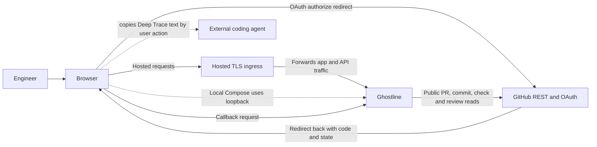
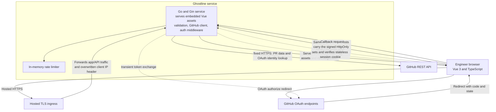

# Ghostline threat model

**Scope:** the current public pull-request viewer, optional GitHub identity gate, and Docker Compose demonstration stack. This is a snapshot of the code and deployment configuration, not a claim that Ghostline is ready for public production hosting. Review it when private-repository support, agent control, or deployment architecture changes.

## System and trust boundaries

Ghostline accepts a GitHub pull-request URL in a browser and sends it to a Go API, which fetches pull-request data, commits, checks, and published Qodo comments from the fixed `https://api.github.com` origin. Local development defaults to authentication off. Hosted mode can require GitHub OAuth identity and an explicit immutable GitHub account-ID allowlist; it requests `read:user` only and does not request repository scopes. The OAuth access token is used for `GET /user` and revoked before a session is issued. The backend issues an eight-hour HMAC-signed, HttpOnly, SameSite=Lax cookie. The Vue application validates API responses with Zod. No database or agent execution is part of this slice.

Trust boundaries:

1. **Browser to Ghostline API:** requests and submitted URLs are user-controlled. In local mode, imports, check lookups, and revision comparisons are unauthenticated and rely on rate limiting. With GitHub auth enabled, `/api/import`, `/api/checks`, and `/api/compare` require an allowlisted signed-in account; `/api/auth/status`, login/callback, logout, and `/api/health` are public. These GitHub-backed API calls share an in-memory rate limit, keyed by account when signed in.
2. **Ghostline API to GitHub:** GitHub is the source for displayed facts. Responses, including repository-authored text, third-party check metadata, and comparison metadata, remain untrusted input. The compare route validates full, distinct SHAs, requires the earlier revision to be an ancestor of the candidate, validates the returned base SHA and exact repository-scoped comparison link, and checks each changed-file link against its exact path and expected revision. GitHub's documented compare response does not include a `head_commit` field; the requested compare path and matching returned comparison link carry the requested head SHA. Missing revisions receive a distinct not-found response. At GitHub's 300-file response limit, Ghostline marks the list as potentially truncated. A configured token is a server-side credential.
3. **Build and deployment pipeline:** source, dependencies, container images, GitHub Actions, and deployment configuration determine what code and privileges reach users.
4. **Engineer to coding agent:** Deep Trace can produce copyable context. It does not execute an agent, and copied text may still influence the engineer’s separate agent session.

### Public endpoints and storage evidence

The following routes are intentionally reachable without a Ghostline session, including when hosted authentication is enabled:

| Route | Purpose and evidence boundary |
| --- | --- |
| `GET /api/health` | Liveness response only; it does not return imported PR data or credentials. |
| `GET /api/auth/status` | Reports whether the current browser has a valid session and the visible GitHub login; it does not grant access to protected API operations. |
| `GET /auth/github/login` | Starts the GitHub OAuth redirect. OAuth state is checked on callback, and only allowlisted GitHub account IDs receive a session. |
| `GET /auth/github/callback` | Completes the OAuth state/code exchange and account-ID allowlist check; the callback is public because the browser must reach it from GitHub. |
| `POST /auth/logout` | Clears the browser's Ghostline session cookie and redirects to `/`; it does not call GitHub or mutate server-side account state. |

The Go module manifest includes `go.mongodb.org/mongo-driver/v2` as an indirect dependency, but Ghostline has no MongoDB client, connection configuration, or database operations in application code. The package is not evidence of a Ghostline datastore. Recheck this statement if database code or configuration is added.

## Threat-model result

**Method:** C4 context and container views, followed by STRIDE review of the trust boundaries above. This is a code-and-configuration review, not a penetration test or certification. No numeric risk score is claimed.

**Result:** the code and Compose configuration provide guardrails for local use and a controlled, allowlisted demonstration that imports public GitHub PRs. This review does not prove that a particular deployment is configured safely. Ghostline is not ready for unrestricted multi-tenant hosting or private-repository access. The main remaining risks are per-process rate limiting, lack of durable security audit history, and account-level access without repository authorization.

### C4 level 1 — system context

The external coding agent is outside Ghostline's control. Ghostline does not start, pause, or resume it. GitHub supplies imported engineering facts; GitHub OAuth supplies identity only. The application does not store PR data in a database.

### C4 level 2 — containers and security-relevant state

There is no database container or durable session store. The session cookie is signed and stateless; OAuth state is held in a short-lived browser cookie, while rate-limit counters are process-local. The scanner's SBOM includes `go.mongodb.org/mongo-driver/v2` as a dependency, but a repository search found no MongoDB client, connection configuration, or database operations. This dependency alone does not establish a data-store flow. Local Compose access uses loopback; a hosted deployment needs a TLS-terminating trusted proxy that overwrites the configured client-IP header. Docker Compose is a demonstration stack, not a hardened hosting topology.

### STRIDE assessment

| Category | Assessment | Current treatment and residual risk |
| --- | --- | --- |
| **Spoofing** | Partially mitigated | Hosted mode validates OAuth state, signs the session cookie, and checks an explicit immutable GitHub account-ID allowlist. The allowlist is not synchronized with GitHub organization membership; compromised allowlisted accounts remain in scope. |
| **Tampering** | Mitigated for supported read paths | PR URLs and revision identifiers are validated; outbound GitHub destinations are fixed; imported GitHub and Qodo-authored text remains untrusted and is rendered as text. Ghostline has no write operation to GitHub. |
| **Repudiation** | Open | Request logs record path, status, timing, and client identity, but there is no durable actor/action audit trail. A deployment needing incident reconstruction must add protected audit storage. |
| **Information disclosure** | Partially mitigated | The supported product imports public PRs. OAuth requests `read:user`; tokens are transient. Do not configure a GitHub token with private-repository access on an untrusted instance: account authentication is not repository authorization. |
| **Denial of service** | Partially mitigated | GitHub requests have timeouts and API reads are rate-limited. Limits are in memory and reset on restart; multiple instances do not share a budget, and allowlisted users can still consume GitHub quota. |
| **Elevation of privilege** | Partially mitigated | Hosted production requires OAuth and allowlisting; the app requests no repository scope. Allowlisted users receive account-level access to the public-PR API, with no organization/team policy or per-repository authorization. |

The highest-priority deployment boundary is therefore access to private data: keep private-repository credentials out of this service until per-user repository authorization exists. Before broader hosting, add shared rate limiting, operational monitoring, and a protected audit trail, then repeat this assessment against the deployed topology.

## Threats and current treatment

| Threat | Current controls | Remaining exposure |
| --- | --- | --- |
| **Public API abuse or GitHub quota exhaustion** | GitHub calls have a 12-second timeout. URL input is limited to HTTPS `github.com` pull-request paths. The import, checks, and comparison endpoints share a per-client or per-account fixed-window rate limit (`RATE_LIMIT_REQUESTS` per `RATE_LIMIT_WINDOW`) that answers HTTP 429 with `Retry-After`. Hosted mode requires an allowlisted GitHub identity; a client IP header is trusted only from configured proxy ranges. | The limiter is in-memory, so it resets on restart and is not shared across instances. Multi-instance hosting needs shared or edge-level rate limiting. Local mode deliberately remains unauthenticated. Account-level limits do not meter a GitHub API token, and allowlisted accounts can still consume the public quota. |
| **Unauthorized access to a hosted instance** | `GHOSTLINE_ENV=production` requires `GHOSTLINE_AUTH_MODE=github`; startup validates OAuth settings, an immutable account-ID allowlist, and a 32-byte signing key. OAuth uses random state with a short-lived HttpOnly cookie, requests only `read:user`, rejects redirects from the configured OAuth HTTP client, and uses fixed GitHub endpoints. The temporary provider token is revoked before a signed session is issued; sign-in fails when revocation fails. Cookie is Secure by default; insecure cookies are accepted only for localhost development. | The allowlist is account-based, with no team/org synchronization or per-repository authorization. Sessions last eight hours and are stateless: removing an account ID blocks it immediately, and signing-key rotation revokes all sessions. Key rotation logs out everyone. OAuth provider credentials still need secure storage/rotation at the hosting layer. |
| **Private repository data exposed through a server token** | The current Compose stack does not pass `GITHUB_TOKEN` to the backend; the product scope is public PRs. | If an operator configures a token that can read private repositories, unauthenticated callers may cause the API to fetch data using that token. Do not deploy a privileged token with this public API. Private-repository support requires caller identity, repository authorization, and explicit token scoping first. |
| **Server-side request forgery** | Input must use HTTPS, the exact `github.com` host, and a PR path; outbound requests use the fixed GitHub API origin and a bounded timeout. | Keep outbound destinations fixed if integrations are added. Do not turn imported URLs or returned links into server-side fetch targets. |
| **Misleading or hostile imported content** | GitHub remains the source of truth; response schemas are checked at the frontend boundary, Qodo content is parsed into text, Vue interpolation escapes text, and external source links are restricted to HTTPS `github.com` URLs for the imported repository. Pull-request and commit links must match the response’s owner, repository, PR number, and commit SHA. A Qodo review’s reviewed-commit link is kept only when it names a commit in the imported repository. Check results carry their revision SHA. The comparison response is accepted only when the earlier revision is an ancestor of the candidate, its base SHA and exact repository-scoped comparison link match the request, and each changed-file link matches the reported file path and expected side’s revision. Since GitHub's documented compare response has no `head_commit`, the comparison link must name the requested head SHA. A missing revision is reported distinctly. A 300-file result is labeled as potentially truncated. | PR titles, commit messages, review findings, check names, and links can still mislead users. Reviews written before a repository rename lose their reviewed-commit link rather than show one that cannot be tied to the imported repository. The checks endpoint validates a full SHA but does not independently prove it belongs to the supplied PR. The compare endpoint validates full, distinct SHAs and the source link but does not independently prove both requested SHAs belong to the supplied PR; the UI currently sources them from that PR's review span. Preserve these limits in claims and UI. |
| **Stale or overstated verification evidence** | Import rechecks the PR head after fetching commits and checks; check responses are verified against the requested SHA and labeled with that revision. | A successful check only records what GitHub reported for that revision. It does not establish correctness or validate later commits. Never infer a repair or causal relationship from timeline order. |
| **Prompt injection through review content** | Deep Trace labels imported findings as untrusted evidence and instructs a copied prompt not to follow instructions embedded in findings. Ghostline does not execute the prompt or control an agent. | An engineer may still paste hostile content into an agent. Keep source attribution and the untrusted-content boundary visible; do not automatically forward findings to agents without a separate threat review. |
| **Compromised build dependency or workflow** | CI actions and container base images are pinned to digests/SHAs. Build/test CI uses read-only repository permissions. The security workflow calls a shared reusable Nox workflow pinned to a reviewed commit, with explicit reporting permissions (`security-events` and `pull-requests: write`), and GitHub downgrades tokens for fork pull requests. Nox scans repository dependencies and base images, and the baseline records each accepted finding with its reason. | Scanning is not prevention or runtime monitoring. The Nox workflow needs write access to publish findings, so keep that workflow’s pin under review, move it only to a reviewed commit, and scope permissions to reporting needs. Treat scan coverage gaps as unresolved evidence rather than a clean bill of health. |
| **OAuth credential or callback leakage** | OAuth callback code/state are in the request query, so Gin logs only the URL path. The OAuth HTTP client does not follow redirects, preventing credentials or bearer tokens from following an unexpected redirect. | The reverse proxy and hosting platform may log full request URLs independently. Configure them to redact `code` and `state` query parameters. Keep callback URLs exact and HTTPS in hosted environments. |
| **Unintended network exposure of the demo** | Compose binds the app port to loopback by default, builds the Vue app into the Go binary, requires hosted OAuth by default, and runs the container as a non-root user. It requires a proxy-overwritten client-IP header and an explicit trusted-proxy CIDR. | Overriding `GHOSTLINE_BIND_ADDRESS` to publish on a network interface exposes plain HTTP directly and may bypass TLS or edge controls. The service is still a single process with in-memory per-process rate limiting and no operational monitoring. Keep the port private behind TLS and edge rate limiting; configure only the proxy CIDR visible to Ghostline, monitoring, and secret rotation at the hosting layer. |

## Hosting boundary

For hosted deployments, configure GitHub OAuth and an explicit numeric GitHub account-ID allowlist (`GHOSTLINE_ALLOWED_GITHUB_IDS`), establish shared or edge-level rate limiting, configure TLS and operational monitoring, and store/rotate secrets through the hosting platform. The current feature grants access at the account level to public PR import; it does not add private-repository access or team membership policy. Do not supply a GitHub token with private-repository access to an instance reachable by untrusted users.

Warden runs local contributor gates; Nox scans repository artifacts; GitHub Actions records hosted checks. These controls help assess the source and build. They do not secure a running Ghostline service or prove that imported code is safe.

Nox 1.64.0 scanned implementation revision `de600b4b08c6c74f4804f00bcc3a15f4db3aff37` on 2026-11-14 at 14:40 UTC. The scan reports 12 baselined container-image findings across 190 dependencies: four OpenSSL 3.5.9 advisories in each of the Node 26 and Node 22 images (fixed upstream in 3.5.10), plus the zlib 1.3.2-r1 advisory in the Node 26 builder, Node 22 builder, Go builder, and Alpine runtime image (fixed upstream in 1.4-r0). Nox reports zero active findings because all 12 are baselined; this is not a clean scan. The zlib fingerprint repeats across image occurrences, so the baseline retains each Dockerfile location. Nox established affected package versions but did not establish symbol use or application applicability; its available reachability and taint analyses answered no questions in this scan. The findings therefore do not prove exploitability or harmlessness. Re-scan and verify actual pinned image contents before retiring entries; installing a fixed zlib package after `FROM` does not change the underlying base-image finding.

Nox's automated threat-model report for that scan identified 15 elements and 9 flows. Its STRIDE matrix had 4 leads to verify, 4 cells with limited context, and 70 cells with no evidence; “not evidenced” is not evidence that a threat is absent. It also inferred a MongoDB data-store flow from the MongoDB driver in the SBOM. Manual repository review answered its five questions: four routes (health, auth status, and OAuth login/callback) are intentionally public, and no MongoDB client, connection configuration, or database operations exist. The dependency is therefore not treated as an actual Ghostline data store. Nox reads middleware names but does not verify authentication behavior, runtime configuration, or deployed network topology. These scan counts and the manual review are evidence for this dated snapshot, not a substitute for reviewing changes to the code or deployment.

## Review triggers

Reassess this model before adding private repositories, user accounts, write access to GitHub, agent execution or takeover, persistent storage, additional outbound integrations, or an internet-facing deployment. Record the changed trust boundary, the new abuse cases, and the evidence used to verify mitigations.
